**full-stack developer from portugal** 🇵🇹

## ✦ hey, i'm tiago

i'm a full-stack developer from portugal with 5 years of experience building things on the web. i'm passionate about innovating, and i specialize in web applications, Discord integrations and multimedia design, combining creativity with technical precision.

these days i'm mostly shipping features, maintaining infrastructure and reviewing PRs across a few products i'm involved in.

i'm also taking a multimedia course to grow as a graphic designer, photographer and coder. i like to aim for the best in school, with A* grades and a regular spot on my school's merit board.

**outside of work**

📸 i'd rather be out taking photos than stuck indoors

🎧 when i'm inside (usually when it's raining), it's coding and music

😴 and i will always make time for a really good sleep

---

## 🧭 where to find me

| | |
|:--|:--|
| 🌐 **portfolio** | [tiagodevs.net](https://tiagodevs.net) |
| 💼 **linkedin** | [https://www.linkedin.com/in/tiagoodevs/](https://www.linkedin.com/in/tiagoodevs/) |
| 💬 **discord** | [message me](https://discord.com/users/90156252594927932) |
| 📧 **email** | [tiagu.1789@gmail.com](mailto:tiagu.1789@gmail.com) |

---

## 🛠️ what i'm working on

[**🏢 Paddlewheel Inc.**](https://paddlewheel.org) · COO -
leading operations and product across HR and management platforms.

[**📡 Monitry**](https://monitry.net) · Director -
uptime monitoring and status pages. [try the beta](https://beta.monitry.net)

[**Delivr**](https://delivrroblox.net) · Director -
hub system for Roblox communities. handles distribution, tracking and management in one place.

**🛰️ [Orbit](https://github.com/planetaryorbit/orbit)**
HR SaaS for staffing, ops and community management. built and maintained end to end.

**💬 [Usercue](https://github.com/Paddlewheel-Inc/usercue)**
open-source feedback platform for product teams.

**🚀 [Boostify](https://github.com/teamboostify/boostify)**
Discord bot that automates server boost management.

---

## ⚡ stack

## ⚡ stack

<b>languages</b>

 

<b>frontend</b>

 

<b>backend & data</b>

 

<b>tooling</b>

 

---

## 🤝 let's build something

i'm always up for interesting projects, collabs, or just talking shop about products and infra. the fastest way to reach me is discord or email.

build • lead • ship • repeat

