hey, i'm tiago — full-stack developer from portugal 🇵🇹, five years building things on the web.

i'm passionate about innovating, and i specialize in web applications, Discord integrations and multimedia design, combining creativity with technical precision. these days i'm mostly shipping features, maintaining infrastructure and reviewing PRs across a few products i'm involved in.

i'm also taking a multimedia course to grow as a graphic designer, photographer and coder. i like to aim for the best in school, with A* grades and a regular spot on my school's merit board.

**outside of work** 📸 i'd rather be out taking photos than stuck indoors 🎧 when i'm inside (usually when it's raining), it's coding and music 😴 and i will always make time for a really good sleep

**[portfolio](https://tiagodevs.net)** &nbsp;·&nbsp; **[linkedin](https://www.linkedin.com/in/tiagoodevs/)** &nbsp;·&nbsp; **[discord](https://discord.com/users/90156252594927932)** &nbsp;·&nbsp; **[email](mailto:tiagu.1789@gmail.com)**

---

### what i'm working on

- **[Paddlewheel Inc.](https://paddlewheel.org)** — COO, leading operations and product across HR and management platforms.
- **[Monitry](https://monitry.net)** — Director, uptime monitoring and status pages. [try the beta](https://beta.monitry.net)
- **[Delivr](https://delivrroblox.net)** — Director, hub system for Roblox communities — distribution, tracking and management in one place.
- **[Orbit](https://github.com/planetaryorbit/orbit)** — HR SaaS for staffing, ops and community management. built and maintained end to end.
- **[Usercue](https://github.com/Paddlewheel-Inc/usercue)** — open-source feedback platform for product teams.
- **[Boostify](https://github.com/teamboostify/boostify)** — Discord bot that automates server boost management.

### stack

- **languages** — JavaScript, TypeScript, Python, Go, Rust, PHP, C, C++
- **frontend** — HTML, CSS, React, Next.js, Tailwind, Angular
- **backend & data** — Node.js, Express, Prisma, Supabase, MongoDB, Postgres, Docker
- **tooling** — Git, GitHub, VS Code, Obsidian, Bash, pnpm, Bun, Yarn, npm, Arch

---

i'm always up for interesting projects, collabs, or just talking shop about products and infra. the fastest way to reach me is discord or email.

  <picture>
    <source media="(prefers-color-scheme: dark)" srcset="./profile/stats-dark.svg">
    
  </picture>

build • lead • ship • repeat

<!-- stats: refreshed daily by .github/workflows/grs.yml (light + dark variants) -->
