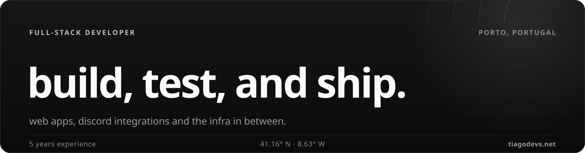
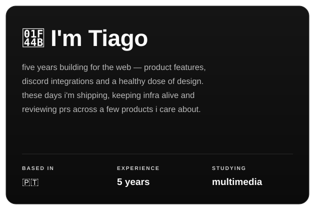
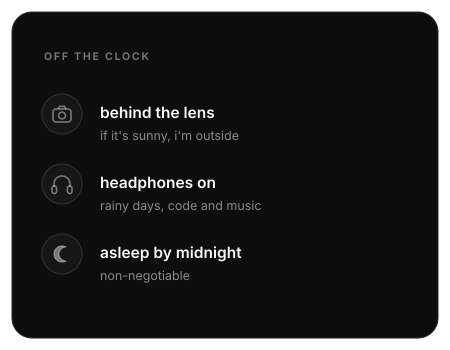
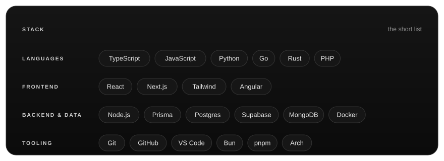
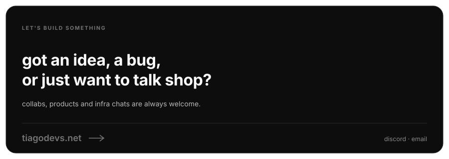

 
<strong>full-stack developer from portugal</strong> 🇵🇹
 
 
   

 

 
  
 
 

 
<b>the work</b> · <a href="https://paddlewheel.org">paddlewheel</a> · <a href="https://monitry.net">monitry</a> · <a href="https://delivrroblox.net">delivr</a> · <a href="https://github.com/planetaryorbit/orbit">orbit</a> · <a href="https://github.com/Paddlewheel-Inc/usercue">usercue</a> · <a href="https://github.com/teamboostify/boostify">boostify</a> 
 
build • lead • ship • repeat

<!-- banner: edit assets/build_banner.py and run `python3 assets/build_banner.py` -->
<!-- cards: edit assets/build_cards.py and run `python3 assets/build_cards.py` -->
<!-- stats: refreshed daily by .github/workflows/grs.yml -->
